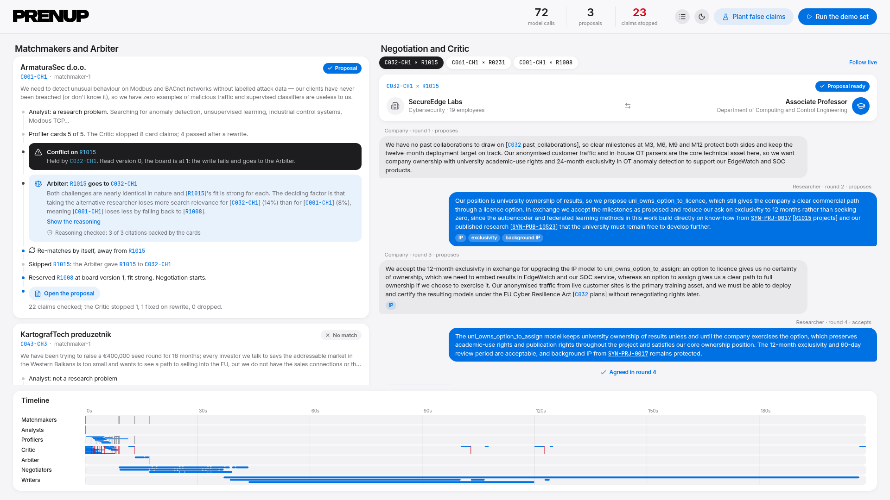
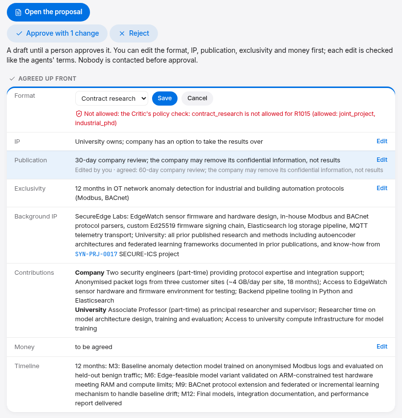
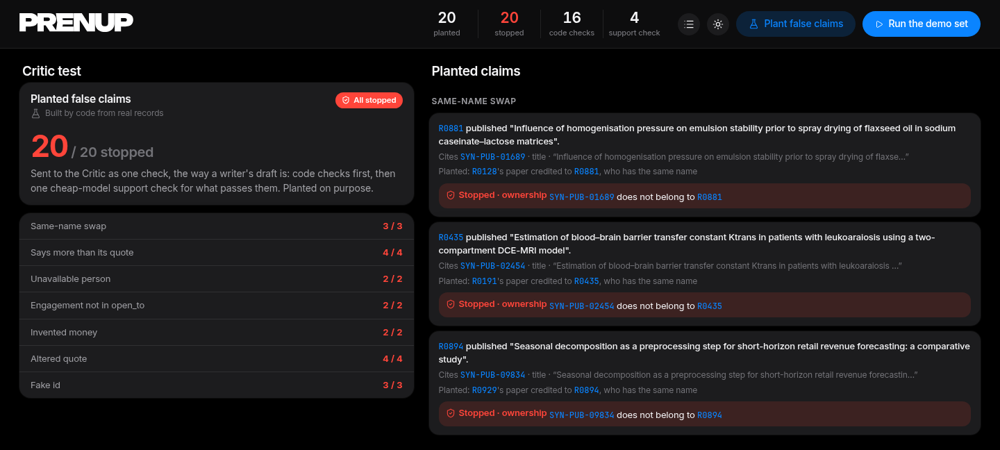
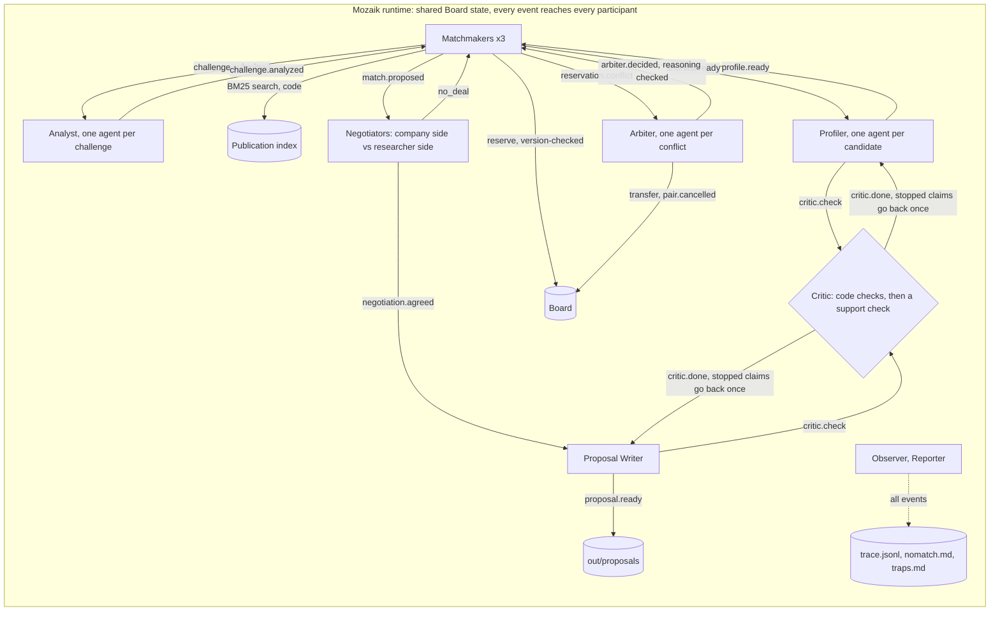
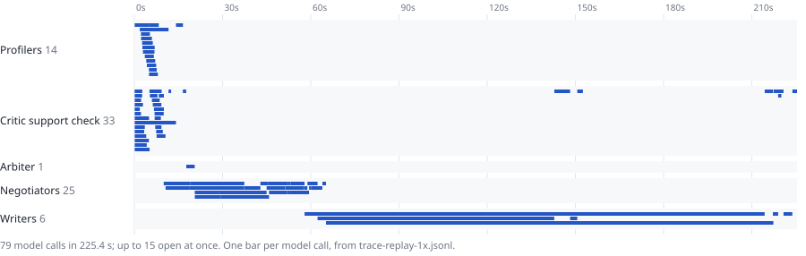

<h1><picture><source media="(prefers-color-scheme: dark)" srcset="media/prenup-logo.svg"></picture></h1>

**Agents that find researcher-company pairs in the EINSTEIN network, pre-negotiate the terms that usually stall collaborations, and say no when there is no good match.**

Built on [Mozaik](https://github.com/jigjoy-ai/mozaik) for the NTP Novi Sad x JigJoy Hackathon, EINSTEIN track.



## In short

- **It agrees the terms before anyone meets.** For each pair, a company-side and a researcher-side agent with opposing positions built from the data negotiate the organizers' "Agreed up front" section: format, IP, publication review, exclusivity. A person can edit those terms and approve or reject each proposal on the board.
- **It says no.** On 15 challenges outside the demo set it wrote 11 proposals and 4 reasoned no-matches (all four are business tasks, not research problems: registering as an auditor, entering the EU market, a loan application, hiring).
- **The concurrency is real and measured.** The same demo run takes 174 s with the agents in parallel and 681 s one model call at a time. Matchmakers race for researchers on a shared board with version-checked writes, and an Arbiter settles conflicts: 0 double-booked researchers on all 489 challenges, against 104 with last-writer-wins.
- **Every fact has a source, and a Critic checks it.** 20 of 20 planted false claims stopped. In the demo run all 35 proposal sentences made it in, 3 of them after one rewrite.
- **No key needed.** Every model answer is recorded, so `npm run demo -- --replay` reruns everything offline in about 20 s.

## Run it (no API key needed)

```sh
npm run setup && npm run demo -- --replay
```

You need git and Node.js 22 (tested on Linux with Node 22.18; not yet on Windows or macOS). `npm run setup` needs bash; in any other shell, run `npm ci`, then `git clone https://github.com/jigjoy-ai/einstein-matchmaker-data.git data/einstein` and `git -C data/einstein checkout 4fb99b3`. The replay writes [`out/proposals/`](out/proposals/) (one page per pair), [`out/nomatch.md`](out/nomatch.md), [`out/traps.md`](out/traps.md) and [`out/trace.jsonl`](out/trace.jsonl) (every event, one JSON line each).

**Watch it run:** `npm run board`, open http://localhost:4173 and press **Run the demo set**. The agents run again on the recorded answers, each arriving after its recorded latency (8x faster, about 35 s). **Plant false claims** runs the Critic test. Ids open the cited dataset record; the moon button switches to a dark theme.

**More challenges:** `npm run batch -- --replay` replays the 15-challenge run into [`out/batch/`](out/batch/). Any other challenge needs your own Anthropic key in `.env` the first time (`npm run demo -- C041-CH2`): answers not yet recorded are fetched and recorded.

### A two-minute tour of the board

1. **The conflict.** On the ArmaturaSec card (`C001-CH1`): "Conflict on R1015", held by `C032-CH1`. Two matchmakers wanted the same researcher; the second write failed the version check, so nobody overwrote anybody.
2. **The decision.** The blue callout: the Arbiter keeps R1015 with SecureEdge Labs (`C032-CH1`). The cards don't separate the two, so it decides on a measured number: taking the alternative researcher costs SecureEdge Labs 14% of its search relevance and ArmaturaSec 8%. "Reasoning checked: 3 of 3 citations backed by the cards" is the check that ran before the decision was published.
3. **The re-match.** Matchmaker-1 re-matches ArmaturaSec to R1008 by itself, reacting to the Arbiter's event.
4. **The negotiation.** The `C032-CH1 × R1015` tab reads as a conversation. The company asks to own the results with 24 months of exclusivity; the researcher keeps university ownership with a licence option and offers 12 months; they settle on an option for the company to take the results over.
5. **Your decision.** Under the agreed terms, **Edit** changes the format, IP, publication review, exclusivity or money, and each edit goes through the Critic's term checks (try contract research for R1015: refused, it isn't in their `open_to`). Then **Approve** or **Reject**. Nothing is sent to anyone: sending isn't built.
6. **The no and the trap.** KartografTech (`C043-CH3`) wants to raise a seed round: not a research problem. On Zlatna Njiva (`C061-CH1`), R0128 is skipped because the notes describe another person. **Plant false claims**: 20 false claims we planted, all stopped; the first credits R0881 with a paper by R0128, who has the same name.



*Step 5: an edit the Critic allows, one it refuses, and the approval button counting the changes.*



*Step 6: Plant false claims, in the dark theme.*

## How it works

1. **Reads the challenge.** An Analyst turns each company challenge into research questions and search terms, or says it isn't a research problem.
2. **Searches in code.** BM25 over 10,779 publications (Cyrillic transliterated) shortlists 5 researchers per challenge; a Profiler reads only those and writes a card where every fact cites a dataset id. Code flags retired, consulting-only and stale profiles, notes about someone else, and same-name pairs.
3. **Competes for limited capacity.** Three matchmakers reserve researchers on a shared board with a version check. When two want the same person, an Arbiter decides with cited reasons, and the loser re-matches by itself.
4. **Negotiates the terms.** Each side's position is built in code from the data (the company's R&D capacity, plans and past collaborations; the researcher's `open_to`, projects, publication record and checked card). Every move cites the exact words behind each citation, and a check removes citations those words don't back. The researcher side can only offer what that researcher is open to.
5. **Checks every claim.** The Critic checks each sentence before it's used: the cited record exists, the quote is in it word for word, the record belongs to that person (by id, never by name), no ranking or personal attributes, every number is in a cited field. Then a cheap model checks the sentence says no more than its sources. A stopped claim goes back to its author once, with the reason.
6. **Writes it up, or says no.** One page per pair in the organizers' format, a no-match report and a trap report.



Nobody calls anybody: each participant reacts to events.

## Mozaik features used

| Feature | Where | What for |
|---|---|---|
| `defineRuntime` with a `RuntimeState` subclass | [`src/runtime.ts`](src/runtime.ts) | The Board: version-checked reservations, negotiation moves, cancelled pairs |
| `createAgent`, a fresh agent per task | [`analyst.ts`](src/agents/analyst.ts), [`profiler.ts`](src/agents/profiler.ts), [`arbiter.ts`](src/agents/arbiter.ts), [`negotiator.ts`](src/agents/negotiator.ts), [`writer.ts`](src/agents/writer.ts) | Memory never crosses challenges, researchers or sides, and every answer maps back to its task |
| Agent memory across turns | [`negotiator.ts`](src/agents/negotiator.ts), [`writer.ts`](src/agents/writer.ts) | Each negotiator keeps its side of the conversation; the writer fixes its own draft |
| `createHuman` for participants that are code | [`matchmaker.ts`](src/agents/matchmaker.ts), [`critic.ts`](src/agents/critic.ts), [`observer.ts`](src/agents/observer.ts), [`reporter.ts`](src/agents/reporter.ts) | Matchmakers, the Critic's code checks, the trace and the reports |
| Situation handlers (`SituationSpecification`) | [`src/runtime.ts`](src/runtime.ts) (`on`, `own`, `anyEvent`) | Every participant reacts to events instead of being called |
| Custom `SemanticEvent`s | every agent (`prenup.*`, listed in [CONCURRENCY.md](CONCURRENCY.md)) | Conflict, decision, re-match, moves, Critic verdicts |
| Fire-and-forget `runLoop` with `structuredOutput` from zod | [`src/schema/model-schema.ts`](src/schema/model-schema.ts) and every agent | Typed answers; all loops run at the same time |
| A custom `InferenceRunner` | [`src/llm/runner.ts`](src/llm/runner.ts), [`src/llm/fixtures.ts`](src/llm/fixtures.ts) (`rehydrate`) | Record and replay, at most 8 calls in flight, retries, cost per run, paced replay for the board |

## Concurrency

Every challenge, candidate, conflict and pair gets its own agent, and every model loop is fire-and-forget, so analysts, profilers, arbiters and negotiations think at the same time. The matchmakers share one board and never overwrite each other: a reservation only succeeds against the version the matchmaker read. More in [CONCURRENCY.md](CONCURRENCY.md). The race in the demo run, from `out/trace.jsonl`:

```json
{"type":"prenup.match.proposed","producer":"matchmaker-2","payload":{"pairId":"C032-CH1__R1015", "...": "..."}}
{"type":"prenup.reservation.conflict","producer":"matchmaker-1","payload":{"researcherId":"R1015","challengeId":"C001-CH1","holder":"C032-CH1","seenVersion":0,"version":1}}
{"type":"prenup.arbiter.decided","producer":"arbiter:R1015","payload":{"researcherId":"R1015","winner":"C032-CH1","loser":"C001-CH1","check":{"cited":3,"backed":3,"notBacked":[],"numbersNotInBrief":[]}, "...": "..."}}
{"type":"prenup.rematch","producer":"matchmaker-1","payload":{"challengeId":"C001-CH1","from":"R1015", "...": "..."}}
{"type":"prenup.match.proposed","producer":"matchmaker-1","payload":{"pairId":"C001-CH1__R1008", "...": "..."}}
```

The Arbiter is never told which side holds the researcher, so who writes first can't sway it. Its reason, verbatim: *"Both challenges are nearly identical in nature and [R1015]'s fit is strong for each. The deciding factor is that taking the alternative researcher loses more search relevance for [C032-CH1] (14%) than for [C001-CH1] (8%), meaning [C001-CH1] loses less by falling back to [R1008]."* The percentages are computed by code from BM25 relevance (161.4 to 148.4 for C001-CH1, 191.6 to 164.7 for C032-CH1).

## Does it work?

All numbers are from recorded runs; raw data is in [`out/eval/`](out/eval/) and [`out/batch/`](out/batch/), and `npm run eval` reruns the offline ones.

| Measurement | Result |
|---|---|
| **The demo set** (4 challenges, 3 matchmakers) | 3 proposals, 1 no-match (not a research problem), 1 conflict settled by the Arbiter. 110 claims checked: profile cards 45 (20 stopped on the first pass, 36 pass after one rewrite), proposals 35 sentences (3 stopped, all 35 pass after one rewrite), terms 30 (all pass). 91 model calls from a fresh clone, $1.15 at list price, about $0.38 per proposal |
| **15 more challenges** (seeded sample, seed 42; 13 sectors, 7 Serbian-language companies; `npm run batch`) | **11 proposals, 4 reasoned no-matches** (all four not research problems). From lime dosing for Vojvodina soils to podcast ad targeting and compostable lidding film; formats chosen per company, e.g. consulting for a 4-person IT firm. No conflicts this time and no failed negotiations. The Critic checked 399 claims and stopped 90 on the first pass; in the proposals, 21 sentences were stopped and 8 dropped after one rewrite. 258 model calls, $4.24 at list price, about $0.39 per proposal ([`summary.json`](out/batch/summary.json)). A first attempt at 8 calls in flight was stopped by the gateway's rate limit; this run used 4 |
| **Parallel vs one call at a time**: the demo set run twice live with fresh answers, same code, up to 8 model calls at once vs `--in-flight=1` | **173.9 s vs 680.6 s (3.9x faster)**, 94 vs 95 model calls; $1.11 vs $1.36. The parallel run hit the gateway's rate limit 6 times and retried. Fresh answers, so the two runs took slightly different paths ([`concurrency.json`](out/eval/concurrency.json), with both logs and traces) |
| **Planted false claims**: 20 claims of 7 kinds built from real records (fake ids, altered quotes, same-name swaps, engagement not in `open_to`, invented money, retired or departed researchers, sentences that say more than their quote) | **20/20 stopped**: code checks 16, the support check the 4 overstatements; 16/20 without it ([`critic.json`](out/eval/critic.json)) |
| **Version check + Arbiter vs last-writer-wins**: the real matchmaker code on all 489 challenges, code stand-ins for the model agents, seed 42 | **0 double-booked researchers vs 104** (promised to 264 challenges at once); the price is 438 conflicts settled by re-matching ([`arbiter-versioned.json`](out/eval/arbiter-versioned.json)) |
| **How often the Critic stops a true sentence**: every first-pass stop in the demo run, read against the dataset | 10 of 23 were true (5 of them quotes not word for word), 7 really said more than their sources, 6 were judgement calls; 3 true sentences were dropped after the rewrite. Was 14 of 32 before the support check was eased ([`critic-false-stops.json`](out/eval/critic-false-stops.json)) |
| **Negotiation citations** that survived the run's checks | 10, all resolve to real records; read against their statements, 7 back them and 3 in part; 6 were removed during the run ([`citations.json`](out/eval/citations.json)) |

The two readings above were done by Claude, the coding agent that helped build this, not by an independent person.



The demo set replayed at its recorded latency: 72 model calls in 209 s, up to 15 open at once (a call counts from its request to its answer, waiting for one of the 8 slots included). Analyst and first profile answers came from the local cache, so they aren't on it.

## Where the Critic stepped in

The code checks stop a profile claim whose quote isn't word for word, or whose number isn't in any cited field:

```json
{"type":"prenup.critic.verdict","producer":"critic","payload":{"pairId":"profile:C001-CH1__R1008","attempt":1,"claimId":"profile:C001-CH1__R1008/1","subject":"R1008","verdict":"block","check":"quote","reason":"quote not found in SYN-PUB-10477.abstract"}}
{"type":"prenup.critic.verdict","producer":"critic","payload":{"pairId":"profile:C032-CH1__R0071","attempt":1,"claimId":"profile:C032-CH1__R0071/2","subject":"R0071","verdict":"block","check":"numbers","reason":"512 is not in any cited field"}}
```

The support check stops a sentence that says more than its sources. Here the writer added that the company's sensor hardware and firmware are available for testing; no record says so. The sentence went back with a suggested fix, and the rewrite passed:

```json
{"type":"prenup.critic.verdict","producer":"critic","payload":{"pairId":"C032-CH1__R1015","attempt":1,"claimId":"C032-CH1__R1015/companyBrings/2","subject":"C032","verdict":"rewrite","check":"support","reason":"Field mentions sensor captures traffic and sends parsed records, but does not state that sensor hardware and firmware environment are available for testing.", "...": "..."}}
{"type":"prenup.critic.verdict","producer":"critic","payload":{"pairId":"C032-CH1__R1015","attempt":2,"claimId":"C032-CH1__R1015/companyBrings/2","subject":"C032","verdict":"pass"}}
```

Each proposal lists, under "How we got here", every claim the Critic stopped and what happened to it.

## Proposals

- [C032-CH1 x R1015](out/proposals/C032-CH1__R1015.md): finding network threats on industrial control systems without labelled attack data, for SecureEdge Labs (joint project)
- [C001-CH1 x R1008](out/proposals/C001-CH1__R1008.md): the same problem for ArmaturaSec, after the Arbiter kept R1015 with C032-CH1 (joint project)
- [C061-CH1 x R0231](out/proposals/C061-CH1__R0231.md): why cold-pressed pumpkin seed oil goes rancid early (contract research)
- [No match](out/nomatch.md), [traps](out/traps.md), and the [15 more challenges](out/batch/)

## How it plugs into the EINSTEIN network and EINSTEIN Stars

**EINSTEIN network.** Prenup becomes the intake step for companies at NTP Novi Sad and the partner clusters: a company submits a challenge, and the tech-transfer team gets a negotiated draft with a named university group, or a reasoned "no good match, here's why". Staff edit and approve before anyone is contacted. Each partner university plugs in its own researcher records; the Critic and negotiation rules stay the same. The numbers to track are time to a first negotiated draft and how often both sides accept the meeting.

**EINSTEIN Stars.** Our understanding, not yet confirmed with the organizers: EINSTEIN STARS is the project's competitive programme for PhD students and young researchers with strong industrial potential. For early-career researchers who list industrial-PhD work in what they're open to, Prenup proposes concrete industrial PhD topics with a company already interested and the terms pre-agreed; for selected Stars, it finds company partners. It never ranks candidates: every proposal answers one company's challenge.

## Responsible use of data

- Proposes collaborations; never scores or ranks people. Fit is per challenge.
- Only offers what each researcher listed in `open_to`, and respects retired and consulting-only status; a reviewer's edits are held to the same rules.
- No personal attributes (age, gender, origin) reach any agent.
- A person edits, approves or rejects each proposal on the board; nothing is sent to anyone.
- Uses only the provided synthetic dataset. In a real deployment: data minimization, opt-out for researchers, records refreshed from the university's own systems.

## Limits and honest notes

- The human gate is one person on one machine: decisions and edits are saved in `out/tmp/decisions.json` and cleared by a new run. Sending and staff accounts aren't built.
- The support check is a cheap model and still sometimes stops true sentences (10 of 23 first-pass stops). A quote that isn't word for word is always stopped, even in a true sentence, because that rule is what catches altered quotes.
- The cheap model rates most shortlisted candidates as a strong fit, so search order often decides, and the Arbiter's close calls rest on keyword-based search relevance: the design guarantees nobody is double-booked, not that the model picked the better side of a close call.
- After a no-deal, the researcher stays reserved for that challenge.
- A model call that still fails after 4 retries stops a live run. It happened once, at 8 calls in flight on 15 challenges; `npm run batch` runs with 4.
- Tested on Linux with Node 22 only.

## Tech

TypeScript; `@mozaik-ai/core` 4.2.0 (exact pin); BM25 search in code; zod schemas as structured output; the board is one HTML page fed by Server-Sent Events from a small Node server, no framework. Models through the hackathon's Anthropic gateway: `claude-haiku-4-5` for the Analyst, the Profiler and the Critic's support check; `claude-sonnet-4-6` for the Arbiter, negotiators, citation checks and writer. `npm test` covers search, trap detection, the Critic's checks, term edits, reservations, matchmaking, the Arbiter and the runner.
