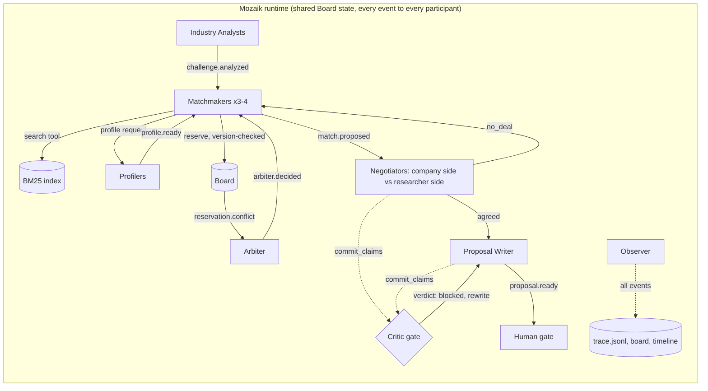

# Prenup

**Agents that find researcher-company pairs in the EINSTEIN network, pre-negotiate the terms that usually stall collaborations, and say no when there is no good match.**

Built on [Mozaik](https://github.com/jigjoy-ai/mozaik) for the NTP Novi Sad x JigJoy Hackathon, EINSTEIN track.

> Work in progress. Every `TODO` below is replaced with measured output before submission.

## Run it in one command (no API key needed)

```sh
npm run setup && npm run demo -- --replay
```

TODO: what appears where (`out/proposals/`, `out/nomatch.md`, `out/traps.md`, `out/trace.jsonl`, board URL). Live run with your own key: `npm run setup && npm run demo`.

## The problem

The organizers' own example proposal ends with a section called **"Agreed up front"**: who owns the results, when they can be published. That is where university-industry collaborations stall. In a UIDP perception survey (Jan 2022, n=64), 71% of university respondents said sponsored-research agreements close within six months, while 54% of industry respondents said seven months or more.

## What it does

TODO: screenshot of the board.

1. Reads every company challenge and translates business language into research questions.
2. Searches 1,047 researchers and 10,779 publications, profiles the shortlist with every fact cited.
3. Matchmakers compete for researchers' limited capacity; an Arbiter settles conflicts.
4. Two negotiators per pair agree the terms from positions grounded in the data.
5. A Critic checks every claim before it is committed.
6. A human approves. Output: one page per pair, a no-match report, a trap report.

## Architecture



TODO: keep in sync with the code at M7.

## How the agents run concurrently

Summary here, details in [CONCURRENCY.md](CONCURRENCY.md). TODO: timeline chart image from `out/eval/timeline`.

## Does it work?

TODO: table from `out/eval/*.json` (subset, seed, models, date): concurrent vs sequential, planted fake facts caught, double-bookings with vs without the Arbiter, traps handled, cost per proposal.

## Where the Critic stepped in

TODO: excerpt from `out/trace.jsonl` showing a blocked claim, the check that caught it, and the rewrite.

## Proposals

TODO: links to at least 3 proposals for 3 different pairs, `out/nomatch.md`, `out/traps.md`.

## How it plugs into the EINSTEIN network and EINSTEIN Stars

**EINSTEIN network.** Prenup becomes the intake step for companies at NTP Novi Sad and the partner clusters. A company submits a challenge; within minutes the tech-transfer team gets either a negotiated draft with a named university group, or a reasoned "no good match, here's why". Staff approve before anyone is contacted. The same engine works for the partner universities in Austria, the Netherlands and Denmark: each institution plugs in its own researcher records, and the Critic and negotiation rules stay the same. The numbers to track are time to a first negotiated draft, and how often both sides accept the meeting.

**EINSTEIN Stars.** TODO: confirm the definition with the organizers. As we understand it, EINSTEIN STARS is the project's competitive programme for PhD students and young researchers with strong industrial potential. Prenup feeds it in both directions. For early-career researchers who list industrial-PhD work in what they're open to, it proposes concrete industrial PhD topics with a company already interested and the terms pre-agreed, which makes a stronger application. For selected Stars, it finds company partners for their work. It never ranks candidates: every proposal answers one company's challenge.

## Responsible use of data

- Proposes collaborations; never scores or ranks people. Fit is per challenge.
- Only offers what each researcher listed in `open_to`; respects retired and consulting-only status.
- No personal attributes (age, gender, origin) reach any agent.
- A human approves before anything leaves the system.
- Uses only the provided synthetic dataset. TODO: plus any cited public sources if used.
- In a real deployment: data minimization, researchers can opt out, records refreshed from the university's own systems.

## Limits and honest notes

TODO: what doesn't work yet, known misses from the evaluation, what we'd do next.

## Tech

TypeScript, `@mozaik-ai/core` (exact version TODO), BM25 search in code, models TODO (cheap for extraction and checks, strong for negotiation).
