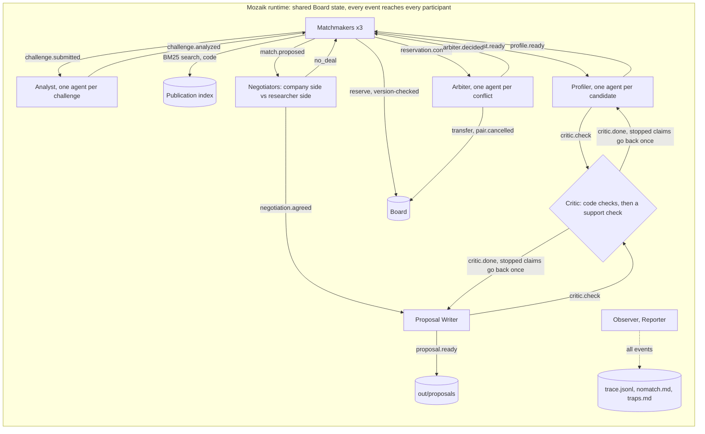

<h1><picture><source media="(prefers-color-scheme: dark)" srcset="media/prenup-logo.svg"></picture></h1>

**Agents that find researcher-company pairs in the EINSTEIN network, pre-negotiate the terms that usually stall collaborations, and say no when there is no good match.**

Built on [Mozaik](https://github.com/jigjoy-ai/mozaik) for the NTP Novi Sad x JigJoy Hackathon, EINSTEIN track.


> Status 30 Oct. Everything below describes what runs today; what isn't built yet is named as such under [Limits](#limits-and-honest-notes).

## Run it in one command (no API key needed)

```sh
npm run setup && npm run demo -- --replay
```

You need git and Node.js 22 (tested on 22.18, Linux; the demo needs at least 20.12, `npm test` at least 22.12). `npm run setup` needs bash. On Windows, use Git Bash or WSL, or run these three lines instead of it in any shell (not tested on Windows or macOS yet):

```sh
npm ci
git clone https://github.com/jigjoy-ai/einstein-matchmaker-data.git data/einstein
git -C data/einstein checkout 4fb99b3
```

`npm run setup` checks your tools, installs dependencies and clones the dataset at a pinned commit. `npm run demo -- --replay` runs the whole system from recorded model answers (`fixtures/`), with no key and no network. It writes:

| Where | What |
|---|---|
| [`out/proposals/`](out/proposals/) | one page per pair, ending with the negotiated "Agreed up front" terms and what the Critic checked |
| [`out/nomatch.md`](out/nomatch.md) | challenges that got no proposal, with the reason and the nearest candidate |
| [`out/traps.md`](out/traps.md) | the dataset's deliberate traps the code caught, with cited examples |
| [`out/trace.jsonl`](out/trace.jsonl) | every event of the run, one JSON line each |

### Watch it run: the live board

```sh
npm run board
```

Open http://localhost:4173 and press **Run the demo set** (the moon button switches to a dark theme). The agents run again on the recorded answers, and each answer arrives after the latency measured when it was recorded (4x faster by default), so the board shows the shape of the live run with no key: matchmakers and the Arbiter on the left, the focused pair's negotiation as a conversation between the two sides and every claim the Critic stopped in the middle, the event log on the right, and one bar per model call on the timeline. Ids link to the cited dataset record, and the header counts calls running, model calls, proposals and claims the Critic stopped. **Plant false claims** runs the Critic test on the board: the 20 planted claims below, each with its source and the check that stopped it. Both buttons write their own trace (`out/tmp/trace.board.jsonl`), so the committed one stays as it is; the board always shows the newest run, so an `npm run demo` started in a terminal shows up too. `npm run demo -- --replay --paced[=N]` is the same paced run from the command line.

### A two-minute tour of the board

Press **Run the demo set**. It takes about 35 s at 4x and ends with 3 proposals, 1 no-match and 47 claims stopped. Then look at:

1. **The conflict.** On the ArmaturaSec card (`C001-CH1`): "Conflict on R1015", held by `C032-CH1`. Two matchmakers wanted the same researcher, and the second write failed the version check. Nobody overwrote anybody.
2. **The decision.** The blue callout below it: the Arbiter keeps R1015 with `C032-CH1`. It calls the two closely matched and decides on a measured number: ArmaturaSec loses 8% of its search relevance by taking its alternative, SecureEdge Labs 14%; "Show the reasoning" has the whole text ([what's weak in it](#limits-and-honest-notes)).
3. **The re-match.** The new tab above the middle column, `C001-CH1 × R1008`. Nobody told matchmaker-1 to do that; it reacted to the Arbiter's event.
4. **The negotiation.** Click the `C032-CH1 × R1015` tab and read down. The company wants to own the results for 24 months of exclusivity, the researcher wants university ownership and offers 12 months, and they settle on the university owning the results with an option for the company to take them over. Below that are **Open the proposal**, **Approve** and **Reject**, then the agreed terms. Every proposal stays a draft until a person decides. The decision is only recorded: sending isn't built, so nobody is contacted.
5. **The Critic.** Click the `C061-CH1 × R0231` tab and scroll down to the red card `companyBrings/1`. The writer said the company's ERP data links production variables to oxidation outcomes, but the source only lists the ERP as inventory tracking. It went back to the writer, and the rewrite passed.
6. **The no.** On the KartografTech card (`C043-CH3`): raising a seed round isn't a research problem. On the Zlatna Njiva card (`C061-CH1`), R0128 is skipped because the notes are about another person.
7. **The trap.** Press **Plant false claims**: 20 false claims we planted on purpose, all stopped in about 5 s. The first row credits R0881 with a paper by R0128, who has the same name. Click `SYN-PUB-01689` and check the author id.

**Run the demo set** brings the demo back after that. The header counts 85 model calls if nothing has run yet and 66 once `out/cache/` exists, because analyst and profile answers are then reused; any earlier run fills it. The outcome is the same. A plain `npm run demo -- --replay` runs the same path at 16x. The live measurements below are separate runs with no cache.

The default run takes the demo set of four challenges. Other challenges (`npm run demo -- C012-CH3 C041-CH2`) need your own Anthropic key in `.env` the first time: `npm run demo` calls the model only for answers not yet recorded, and records them.

## The problem

The organizers' own example proposal ends with a section called **"Agreed up front"**: who owns the results, when they can be published. That is where university-industry collaborations stall. In a UIDP perception survey (Jan 2022, n=64), 71% of university respondents said sponsored-research agreements close within six months, while 54% of industry respondents said seven months or more.

## What it does

1. **Reads the challenge like a researcher would.** An Analyst rewrites each company challenge into research questions and academic search terms, or says it isn't a research problem.
2. **Searches in code, reads only the shortlist.** BM25 over 10,779 publication titles, keywords and abstracts (Cyrillic transliterated) shortlists 5 researchers per challenge. A Profiler reads only those and writes a card where every fact cites a dataset id; code flags stale, retired and consulting-only profiles, notes about someone else, and same-name pairs.
3. **Competes for limited capacity.** Three matchmakers reserve researchers on a shared board with a version check. When two want the same person, an Arbiter decides with cited reasons and the loser re-matches by itself.
4. **Negotiates the terms up front.** For each pair, a company-side and a researcher-side negotiator agree the engagement type, IP (Lambert Toolkit models), publication review and exclusivity in capped rounds, or walk away. Each side's position is built in code from the data: the company's R&D capacity, past collaborations and products; the researcher's `open_to`, earlier projects, patents, publication record and the Profiler's checked card. The researcher side can only offer what that researcher listed as open to.
5. **Checks every claim.** A Critic checks each fact before it is used: the cited record exists, the quote is in it word for word, the record belongs to that person (by id, never by name), no ranking or personal attributes, and every number is in a quote. Then a cheap model checks that the sentence says no more than its quotes. A claim it stops goes back to its author once, with the reason; what still fails is dropped.
6. **Writes it up, or says no.** One page per pair, a no-match report and a trap report.

## Architecture



Nobody calls anybody: each participant reacts to events. Every model call goes through one runner that records and replays answers, caps calls in flight and retries rate limits.

## How the agents run concurrently

Every challenge, candidate, conflict and pair gets its own agent, and every model loop is fire-and-forget, so analysts, profilers, arbiters and negotiations for different pairs think at the same time (up to 8 calls in flight). The matchmakers share one board and never overwrite each other: a reservation only succeeds against the version the matchmaker read. Details, the feedback loops and a trace excerpt: [CONCURRENCY.md](CONCURRENCY.md).

In the demo run, C001-CH1 (ArmaturaSec) and C032-CH1 (SecureEdge Labs) post almost the same challenge and both want R1015. This is from `out/trace.jsonl`:

```json
{"type":"prenup.match.proposed","producer":"matchmaker-2","payload":{"pairId":"C032-CH1__R1015", "...": "..."}}
{"type":"prenup.reservation.conflict","producer":"matchmaker-1","payload":{"researcherId":"R1015","challengeId":"C001-CH1","holder":"C032-CH1","seenVersion":0,"version":1}}
{"type":"prenup.arbiter.decided","producer":"arbiter:R1015","payload":{"researcherId":"R1015","winner":"C032-CH1","loser":"C001-CH1", "...": "..."}}
{"type":"prenup.rematch","producer":"matchmaker-1","payload":{"challengeId":"C001-CH1","from":"R1015", "...": "..."}}
{"type":"prenup.match.proposed","producer":"matchmaker-1","payload":{"pairId":"C001-CH1__R1008", "...": "..."}}
```

Matchmaker-2 reserved R1015 first; matchmaker-1's write then failed the version check. The Arbiter kept R1015 with C032-CH1, and matchmaker-1 re-matched C001-CH1 to R1008 by itself. Who writes first depends on timing: in the live recording ([`out/trace-recording.jsonl`](out/trace-recording.jsonl)) matchmaker-1 wrote first, so its negotiation was cancelled mid-way when the Arbiter decided. The Arbiter is never told which side holds the researcher, so it decides the same way both times.

From the Arbiter's reason, verbatim: *"Both challenges are closely matched in fit for [R1015], with [SYN-PUB-10523] and [SYN-PUB-10525] appearing on both cards. However, [C032-CH1]'s card additionally cites federated learning work [SYN-PUB-10526], providing a marginally broader alignment. More decisively, [C001-CH1] loses only 8% search relevance by taking its alternative [R1008], while [C032-CH1] loses 14% — meaning [C032-CH1] is more harmed by losing [R1015] to its alternative."*. The percentages are measured: each is how much BM25 relevance that challenge loses by taking R1008 instead of R1015 (161.4 to 148.4, and 191.6 to 164.7). We checked its citations by hand: each publication is authored by the researcher it is cited for. Nobody told matchmaker-1 to pick R1008; it reacted to the decision.

## Does it work?

Measured on the demo run (4 challenges, 3 matchmakers, models below):

| What | Result |
|---|---|
| Challenges | 4: 3 proposals, 1 no-match (not a research problem) |
| Reservation conflicts | 1, settled by the Arbiter; the loser re-matched; no researcher ends up with two challenges |
| Claims checked by the Critic | 111. Profile cards: 45, of which 34 were stopped on the first pass (23 said more than their quotes, 7 quotes not word for word, 4 numbers not in any quote); after one rewrite 27 pass and 18 are dropped. Proposals: 36 sentences, 13 stopped by the support check; after one rewrite 31 pass and 5 are dropped. Negotiated terms: 30, all pass |
| Traps the code flags across all 1,047 profiles | 22 stale (6 unavailable, 16 consulting only), 7 where `open_to` contradicts the notes, 2 notes about another person, 8 same-name profiles, 26 with Cyrillic text ([`out/traps.md`](out/traps.md)) |
| Model calls per run (replay from a fresh clone) | 67 cheap (100,740 input / 18,189 output tokens), 18 strong (73,593 input / 21,414 output tokens) |
| Cost of one demo run | $0.72 at list price ($0.19 cheap, $0.53 strong), about $0.24 per proposal; every run prints its own |

And three measurements made for the question "does the design hold up?" (`npm run eval`; results and raw data in [`out/eval/`](out/eval/)):

| Measurement | Result |
|---|---|
| **Concurrent vs one call at a time**: the demo set run twice live on 30 Oct, same code, up to 8 model calls at once vs `--in-flight=1` | **170.7 s vs 380.3 s (2.2x faster)**, 89 model calls each; $1.04 vs $0.80. The concurrent run hit the gateway's rate limit 11 times and retried. Fresh answers, so the two runs took slightly different paths ([`concurrency.json`](out/eval/concurrency.json)) |
| **Planted false claims**: 20 claims of 7 kinds built from real records (fake ids, altered quotes, same-name swaps, engagement not in `open_to`, invented money, retired or departed researchers, sentences that say more than their quote), sent to the Critic as one check | **20/20 stopped.** The code checks stop 16 (exists 3, quote 4, ownership 3, policy 5, numbers 1); the 4 overstatements pass them and are stopped by the support check. Without the support check: 16/20. The faults go to the Critic directly, not through the writer ([`critic.json`](out/eval/critic.json)) |
| **Version check + Arbiter vs last-writer-wins**: the real matchmaker code on all 489 challenges, with code stand-ins for the model agents (search on the one-line challenge text, every card a strong fit, real availability and trap flags, the holder keeps a contested researcher), seed 42 | **0 double-booked researchers vs 104** (promised to 264 challenges at once). The price: 438 conflicts settled by re-matching, and 50 challenges whose whole shortlist was already taken ([`arbiter-versioned.json`](out/eval/arbiter-versioned.json), [`arbiter-last-writer-wins.json`](out/eval/arbiter-last-writer-wins.json)) |


The demo set on a timeline, replayed at its recorded latency: 66 model calls in 120 s, 3.1 open on average and up to 15 at once (a call counts from its request to its answer, waiting for one of the 8 slots included). Analysts and first profile answers came from the local cache, so they aren't on it. The 170.7 s vs 380.3 s measurement above was made before the last change to the negotiator and Arbiter prompts.

How often it stops a true claim: of the 47 first-pass stops in the demo run, **21 sentences were true, 15 really said more than their sources and 11 were judgement calls** ([`critic-false-stops.json`](out/eval/critic-false-stops.json) has each one). So the Critic is too strict: 10 of the 21 true sentences never came back after the rewrite. Claude, the coding agent that helped build this, did this review, not an independent person.

## Where the Critic stepped in

The cheap model writes the profile cards, and it sometimes rewords a "verbatim" quote or adds a number its quote doesn't contain. The Critic's code checks block those claims before any matchmaker sees the card (`out/trace.jsonl`):

```json
{"type":"prenup.critic.verdict","producer":"critic","payload":{"pairId":"profile:C001-CH1__R1015","attempt":1,"claimId":"profile:C001-CH1__R1015/2","subject":"R1015","verdict":"block","check":"numbers","reason":"94 is not in any quoted source"}}
{"type":"prenup.critic.verdict","producer":"critic","payload":{"pairId":"profile:C001-CH1__R1008","attempt":1,"claimId":"profile:C001-CH1__R1008/1","subject":"R1008","verdict":"block","check":"quote","reason":"quote not found in SYN-PUB-10477.abstract"}}
```

A quote can be word for word and still not say what the sentence says. The support check catches that, the claim goes back to its author with the reason and a suggested sentence, and the fix is checked again. Here the writer said the company's ERP data links production variables to oxidation outcomes; the source only lists the ERP as inventory tracking:

```json
{"type":"prenup.critic.verdict","producer":"critic","payload":{"pairId":"C061-CH1__R0231","attempt":1,"claimId":"C061-CH1__R0231/companyBrings/1","subject":"C061","verdict":"rewrite","check":"support","reason":"Quotes confirm field/harvest traceability and ERP tracking, but do not state that ERP data links production variables to oxidation outcomes; that is an inference.","...":"..."}}
{"type":"prenup.critic.verdict","producer":"critic","payload":{"pairId":"C061-CH1__R0231","attempt":2,"claimId":"C061-CH1__R0231/companyBrings/1","subject":"C061","verdict":"pass"}}
```

Each proposal lists, under "How we got here", every claim the Critic stopped, why, and whether the rewrite passed or was dropped.

## Proposals

- [C032-CH1 x R1015](out/proposals/C032-CH1__R1015.md): unsupervised anomaly detection on Modbus and BACnet traffic for SecureEdge Labs' edge sensors (joint project)
- [C001-CH1 x R1008](out/proposals/C001-CH1__R1008.md): the same problem for ArmaturaSec, after the Arbiter gave R1015 to C032-CH1 (joint project)
- [C061-CH1 x R0231](out/proposals/C061-CH1__R0231.md): why cold-pressed pumpkin seed oil goes rancid (contract research). R0128 was on this shortlist and skipped: its notes describe another person
- [No match](out/nomatch.md): C043-CH3, raising a seed round, is not a research problem
- [Traps](out/traps.md)

## How it plugs into the EINSTEIN network and EINSTEIN Stars

**EINSTEIN network.** Prenup becomes the intake step for companies at NTP Novi Sad and the partner clusters. A company submits a challenge; within minutes the tech-transfer team gets either a negotiated draft with a named university group, or a reasoned "no good match, here's why". Staff approve before anyone is contacted. The same engine works for the partner universities in Austria, the Netherlands and Denmark: each institution plugs in its own researcher records, and the Critic and negotiation rules stay the same. The numbers to track are time to a first negotiated draft, and how often both sides accept the meeting.

**EINSTEIN Stars.** Our understanding, not yet confirmed with the organizers: EINSTEIN STARS is the project's competitive programme for PhD students and young researchers with strong industrial potential. Prenup feeds it in both directions. For early-career researchers who list industrial-PhD work in what they're open to, it proposes concrete industrial PhD topics with a company already interested and the terms pre-agreed, which makes a stronger application. For selected Stars, it finds company partners for their work. It never ranks candidates: every proposal answers one company's challenge.

## Responsible use of data

- Proposes collaborations; never scores or ranks people. Fit is per challenge.
- Only offers what each researcher listed in `open_to`; respects retired and consulting-only status.
- No personal attributes (age, gender, origin) reach any agent.
- A person approves or rejects each proposal on the board. Nothing is sent to anyone: sending isn't built.
- Uses only the provided synthetic dataset; no external sources.
- In a real deployment: data minimization, researchers can opt out, records refreshed from the university's own systems.

## Limits and honest notes

- The human approval step is a simple gate on the board: one person, one decision per proposal, saved on this machine (`out/tmp/decisions.json`) and cleared by a new run. Not built yet: sending, staff accounts, and editing a draft before approving it.
- The support check is a cheap model and strict: it stopped a third of the proposal sentences on the first pass, and about 4 in 10 of all first-pass stops were true sentences (see [Does it work?](#does-it-work)). It reads only the claim's quotes, so a true sentence with too short a quote goes back: it stopped a sentence saying real incidents are rare and customers don't allow attack simulations on live plant, which `C032-CH1`'s text says outright, and the sentence was dropped. The people-praise check is a word list, and it also blocked a sentence that called a method's result "best".
- The cheap model rates most shortlisted candidates as a strong fit, so search order often decides. The Arbiter's and the Profiler's fit reasons aren't checked by the Critic yet. We checked by hand that each paper the Arbiter cites is by the researcher it's cited for. The two challenges are nearly identical, so the decision rests on a measured tiebreak, 8% vs 14% of search relevance. Search relevance is keyword-based, so that shows which challenge loses more on paper, not which pairing would work better. What the design guarantees is that nobody is double-booked, not that the model picked the better side of a close call.
- After a no-deal the researcher stays reserved for that challenge.
- Negotiators are told to cite a field only for a fact it states and to word their stances as positions. All 17 field citations in the recorded moves point to real fields, but the Critic doesn't check them during a run. Reading each one against the statement it's attached to, 9 hold up, 6 hold up in part and 2 don't: `C032-CH1 × R1015` round 1 cites `C032 tech` and `C061-CH1 × R0231` round 1 cites `C061 rd_capacity` for protecting data ([`citations.json`](out/eval/citations.json)). Claude did this reading, not an independent person. A model check we tried first misjudged simple cases, so we left it out.
- Tested on Linux with Node 22 only.

## Tech

TypeScript; `@mozaik-ai/core` 4.2.0 (exact pin); BM25 search in code; zod schemas as structured output; the board is one HTML page fed by Server-Sent Events from a small Node server, no framework. Models through the hackathon's Anthropic gateway: `claude-haiku-4-5` for the Analyst, the Profiler and the Critic's support check, `claude-sonnet-4-6` for the Arbiter, negotiators and writer. Every model answer is recorded in `fixtures/`, so runs replay without a key. `npm test` covers search, trap detection, the Critic's checks, reservations, matchmaking, the Arbiter and the runner.
