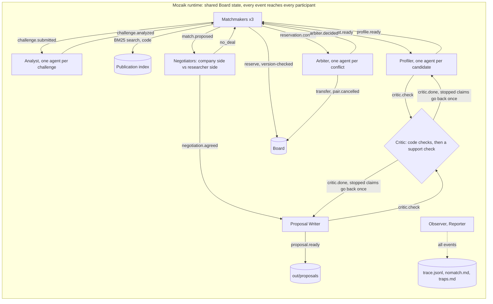

# Prenup

**Agents that find researcher-company pairs in the EINSTEIN network, pre-negotiate the terms that usually stall collaborations, and say no when there is no good match.**

Built on [Mozaik](https://github.com/jigjoy-ai/mozaik) for the NTP Novi Sad x JigJoy Hackathon, EINSTEIN track.

> Status 30 Oct. Everything below describes what runs today; what isn't built yet is named as such under [Limits](#limits-and-honest-notes).

## Run it in one command (no API key needed)

```sh
npm run setup && npm run demo -- --replay
```

`npm run setup` checks your tools, installs dependencies and clones the dataset at a pinned commit. `npm run demo -- --replay` runs the whole system from recorded model answers (`fixtures/`), with no key and no network. It writes:

| Where | What |
|---|---|
| [`out/proposals/`](out/proposals/) | one page per pair, ending with the negotiated "Agreed up front" terms and what the Critic checked |
| [`out/nomatch.md`](out/nomatch.md) | challenges that got no proposal, with the reason and the nearest candidate |
| [`out/traps.md`](out/traps.md) | the dataset's deliberate traps the code caught, with cited examples |
| [`out/trace.jsonl`](out/trace.jsonl) | every event of the run, one JSON line each |

### Watch it run: the live board

```sh
npm run board
```

Open http://localhost:4173 and press **Run the demo set**. The agents run again on the recorded answers, and each answer arrives after the latency measured when it was recorded (4x faster by default), so the board shows the shape of the live run with no key: matchmakers and the Arbiter on the left, the focused pair's negotiation and every claim the Critic stopped in the middle, the event log on the right, and one bar per model call on the timeline. Ids link to the cited dataset record. The board follows `out/trace.jsonl`, so any `npm run demo` shows up there too; `npm run demo -- --replay --paced[=N]` is the same paced run from the command line.

The default run takes the demo set of four challenges. Other challenges (`npm run demo -- C012-CH3 C041-CH2`) need your own Anthropic key in `.env` the first time: `npm run demo` calls the model only for answers not yet recorded, and records them.

## The problem

The organizers' own example proposal ends with a section called **"Agreed up front"**: who owns the results, when they can be published. That is where university-industry collaborations stall. In a UIDP perception survey (Jan 2022, n=64), 71% of university respondents said sponsored-research agreements close within six months, while 54% of industry respondents said seven months or more.

## What it does

1. **Reads the challenge like a researcher would.** An Analyst rewrites each company challenge into research questions and academic search terms, or says it isn't a research problem.
2. **Searches in code, reads only the shortlist.** BM25 over 10,779 publication titles, keywords and abstracts (Cyrillic transliterated) shortlists 5 researchers per challenge. A Profiler reads only those and writes a card where every fact cites a dataset id; code flags stale, retired and consulting-only profiles, notes about someone else, and same-name pairs.
3. **Competes for limited capacity.** Three matchmakers reserve researchers on a shared board with a version check. When two want the same person, an Arbiter decides with cited reasons and the loser re-matches by itself.
4. **Negotiates the terms up front.** For each pair, a company-side and a researcher-side negotiator agree the engagement type, IP (Lambert Toolkit models), publication review and exclusivity in capped rounds, or walk away. Each side's position is built in code from the data: the company's R&D capacity, past collaborations and products; the researcher's `open_to`, earlier projects, patents, publication record and the Profiler's checked card. The researcher side can only offer what that researcher listed as open to.
5. **Checks every claim.** A Critic checks each fact before it is used: the cited record exists, the quote is in it word for word, the record belongs to that person (by id, never by name), no ranking or personal attributes, and every number is in a quote. Then a cheap model checks that the sentence says no more than its quotes. A claim it stops goes back to its author once, with the reason; what still fails is dropped.
6. **Writes it up, or says no.** One page per pair, a no-match report and a trap report.

## Architecture



Nobody calls anybody: each participant reacts to events. Every model call goes through one runner that records and replays answers, caps calls in flight and retries rate limits.

## How the agents run concurrently

Every challenge, candidate, conflict and pair gets its own agent, and every model loop is fire-and-forget, so analysts, profilers, arbiters and negotiations for different pairs think at the same time (up to 8 calls in flight). The matchmakers share one board and never overwrite each other: a reservation only succeeds against the version the matchmaker read. Details, the feedback loops and a trace excerpt: [CONCURRENCY.md](CONCURRENCY.md).

In the demo run, C001-CH1 (ArmaturaSec) and C032-CH1 (SecureEdge Labs) post almost the same challenge and both want R1015. This is from `out/trace.jsonl`:

```json
{"type":"prenup.match.proposed","producer":"matchmaker-2","payload":{"pairId":"C032-CH1__R1015", "...": "..."}}
{"type":"prenup.reservation.conflict","producer":"matchmaker-1","payload":{"researcherId":"R1015","challengeId":"C001-CH1","holder":"C032-CH1","seenVersion":0,"version":1}}
{"type":"prenup.pair.cancelled","producer":"arbiter:R1015","payload":{"pairId":"C032-CH1__R1015","reason":"the Arbiter gave R1015 to C001-CH1"}}
{"type":"prenup.arbiter.decided","producer":"arbiter:R1015","payload":{"researcherId":"R1015","winner":"C001-CH1","loser":"C032-CH1", "...": "..."}}
{"type":"prenup.rematch","producer":"matchmaker-2","payload":{"challengeId":"C032-CH1","from":"R1015", "...": "..."}}
{"type":"prenup.match.proposed","producer":"matchmaker-2","payload":{"pairId":"C032-CH1__R1008", "...": "..."}}
```

Matchmaker-2 reserved R1015 first and its negotiation had started; matchmaker-1's write then failed the version check. The Arbiter gave R1015 to C001-CH1, so the C032-CH1 negotiation was cancelled mid-way and matchmaker-2 re-matched to R1008. Who writes first depends on timing: in a plain `--replay`, where every answer arrives at once, matchmaker-1 wins the race; this trace comes from `--paced`, which keeps the recording run's timing. The Arbiter is never told which side holds the researcher, so it decides the same way both times.

From the Arbiter's reason, verbatim: *"Both challenges are nearly identical and [R1015] fits both strongly, but [C032-CH1] has an equally strong alternative in [R1008] with directly relevant work [SYN-PUB-10472, SYN-PUB-10477, SYN-PUB-10239] … [C001-CH1]'s card shows more precise alignment with [R1015]'s published hybrid deployment guidance [SYN-PUB-10525]"*. We checked its citations by hand: each publication is authored by the researcher it is cited for. Nobody told matchmaker-2 to pick R1008; it reacted to the decision.

## Does it work?

Measured on the demo run (4 challenges, 3 matchmakers, models below):

| What | Result |
|---|---|
| Challenges | 4: 3 proposals, 1 no-match (not a research problem) |
| Reservation conflicts | 1, settled by the Arbiter; the loser re-matched; no researcher ends up with two challenges |
| Claims checked by the Critic | 111. Profile cards: 45, of which 34 were stopped on the first pass (23 said more than their quotes, 7 quotes not word for word, 4 numbers not in any quote); after one rewrite 27 pass and 18 are dropped. Proposals: 36 sentences, 12 stopped by the support check; after one rewrite 32 pass and 4 are dropped. Negotiated terms: 30, all pass |
| Traps the code flags across all 1,047 profiles | 22 stale (6 unavailable, 16 consulting only), 7 where `open_to` contradicts the notes, 2 notes about another person, 8 same-name profiles, 26 with Cyrillic text ([`out/traps.md`](out/traps.md)) |
| Model calls per run (replay from a fresh clone) | 67 cheap (100,855 input / 18,120 output tokens), 19 strong (77,370 input / 23,994 output tokens) |

Not measured yet: concurrent vs sequential wall-clock, how many planted false facts the Critic catches, and double-bookings with the Arbiter vs last-writer-wins.

## Where the Critic stepped in

The cheap model writes the profile cards, and it sometimes rewords a "verbatim" quote or adds a number its quote doesn't contain. The Critic's code checks block those claims before any matchmaker sees the card (`out/trace.jsonl`):

```json
{"type":"prenup.critic.verdict","producer":"critic","payload":{"pairId":"profile:C001-CH1__R1015","attempt":1,"claimId":"profile:C001-CH1__R1015/2","subject":"R1015","verdict":"block","check":"numbers","reason":"94 is not in any quoted source"}}
{"type":"prenup.critic.verdict","producer":"critic","payload":{"pairId":"profile:C001-CH1__R1008","attempt":1,"claimId":"profile:C001-CH1__R1008/1","subject":"R1008","verdict":"block","check":"quote","reason":"quote not found in SYN-PUB-10477.abstract"}}
```

A quote can be word for word and still not say what the sentence says. The support check catches that, the claim goes back to its author with the reason and a suggested sentence, and the fix is checked again. Here the writer said the company's hardware bench includes PLC simulators; the quote doesn't say so:

```json
{"type":"prenup.critic.verdict","producer":"critic","payload":{"pairId":"C001-CH1__R1015","attempt":1,"claimId":"C001-CH1__R1015/companyBrings/2","subject":"C001","verdict":"rewrite","check":"support","reason":"Quote confirms access to traffic archives, hardware bench, and firmware under NDA, but does not specify that hardware includes 'physical PLC simulators'.", "...": "..."}}
{"type":"prenup.writer.rewrote","producer":"writer","payload":{"pairId":"C001-CH1__R1015","sentBack":["C001-CH1__R1015/companyBrings/1","C001-CH1__R1015/companyBrings/2","C001-CH1__R1015/whyThisPair/2","C001-CH1__R1015/whyThisPair/3"], "...": "..."}}
{"type":"prenup.critic.verdict","producer":"critic","payload":{"pairId":"C001-CH1__R1015","attempt":2,"claimId":"C001-CH1__R1015/companyBrings/2","subject":"C001","verdict":"pass"}}
```

Each proposal lists, under "How we got here", every claim the Critic stopped, why, and whether the rewrite passed or was dropped.

## Proposals

- [C001-CH1 x R1015](out/proposals/C001-CH1__R1015.md): unsupervised anomaly detection on Modbus and BACnet traffic for ArmaturaSec (joint project)
- [C032-CH1 x R1008](out/proposals/C032-CH1__R1008.md): the same problem on SecureEdge Labs' edge sensors, after the Arbiter gave R1015 to C001-CH1 (contract research)
- [C061-CH1 x R0231](out/proposals/C061-CH1__R0231.md): why cold-pressed pumpkin seed oil goes rancid (contract research). R0128 was on this shortlist and skipped: its notes describe another person
- [No match](out/nomatch.md): C043-CH3, raising a seed round, is not a research problem
- [Traps](out/traps.md)

## How it plugs into the EINSTEIN network and EINSTEIN Stars

**EINSTEIN network.** Prenup becomes the intake step for companies at NTP Novi Sad and the partner clusters. A company submits a challenge; within minutes the tech-transfer team gets either a negotiated draft with a named university group, or a reasoned "no good match, here's why". Staff approve before anyone is contacted. The same engine works for the partner universities in Austria, the Netherlands and Denmark: each institution plugs in its own researcher records, and the Critic and negotiation rules stay the same. The numbers to track are time to a first negotiated draft, and how often both sides accept the meeting.

**EINSTEIN Stars.** Our understanding, not yet confirmed with the organizers: EINSTEIN STARS is the project's competitive programme for PhD students and young researchers with strong industrial potential. Prenup feeds it in both directions. For early-career researchers who list industrial-PhD work in what they're open to, it proposes concrete industrial PhD topics with a company already interested and the terms pre-agreed, which makes a stronger application. For selected Stars, it finds company partners for their work. It never ranks candidates: every proposal answers one company's challenge.

## Responsible use of data

- Proposes collaborations; never scores or ranks people. Fit is per challenge.
- Only offers what each researcher listed in `open_to`; respects retired and consulting-only status.
- No personal attributes (age, gender, origin) reach any agent.
- Planned: a human approves before anyone is contacted (not built yet).
- Uses only the provided synthetic dataset; no external sources.
- In a real deployment: data minimization, researchers can opt out, records refreshed from the university's own systems.

## Limits and honest notes

- Not built yet: the human approval step.
- The support check is a cheap model and strict: it stopped a third of the proposal sentences on the first pass. How many planted false facts it catches is not measured yet. The people-praise check is a word list, and it also blocked a sentence that called a method's result "best".
- The cheap model rates most shortlisted candidates as a strong fit, so search order often decides. The Arbiter's and the Profiler's fit reasons aren't checked by the Critic yet (we checked the Arbiter's citations above by hand).
- After a no-deal the researcher stays reserved for that challenge.
- Negotiators cite fields of their position cards in each move; the Critic doesn't check those citations yet.

## Tech

TypeScript; `@mozaik-ai/core` 4.2.0 (exact pin); BM25 search in code; zod schemas as structured output; the board is one HTML page fed by Server-Sent Events from a small Node server, no framework. Models through the hackathon's Anthropic gateway: `claude-haiku-4-5` for the Analyst, the Profiler and the Critic's support check, `claude-sonnet-4-6` for the Arbiter, negotiators and writer. Every model answer is recorded in `fixtures/`, so runs replay without a key. `npm test` covers search, trap detection, the Critic's checks, reservations, matchmaking, the Arbiter and the runner.
